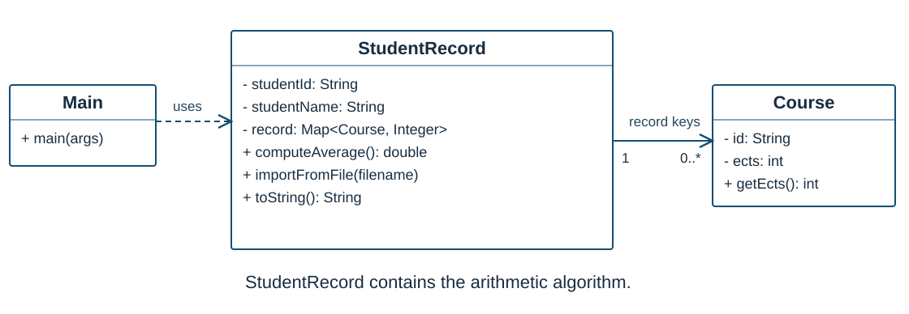
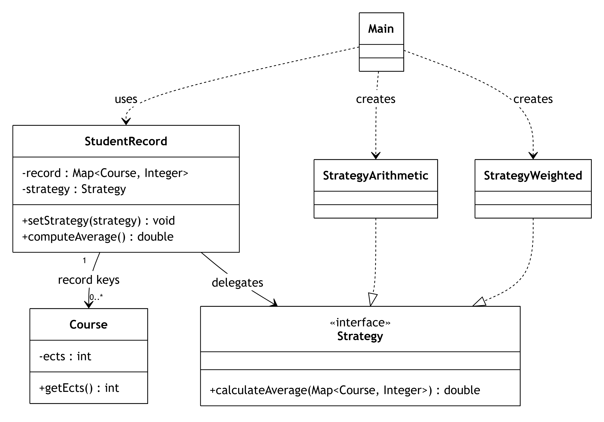

# A4.2 — Padrão Strategy: ficha de aluno

**TA-POO · 2026/27**

## Ponto de partida

Este projeto modela o percurso académico de um aluno. `StudentRecord` guarda
um `Map<Course, Integer>` que associa cada UC à respetiva classificação.
`Course` contém o identificador, ano, nome, semestre e ECTS da UC.

A versão fornecida importa `record.csv`, apresenta a ficha e calcula a **média
aritmética**, diretamente em `StudentRecord.computeAverage()`.
O padrão Strategy ainda não está implementado. A interface e as classes das
estratégias devem ser criadas durante a atividade.

## Objetivos

- Identificar o comportamento que varia e separá-lo dos restantes dados e operações.
- Aplicar composição e polimorfismo através de uma interface comum.
- Alterar a estratégia em tempo de execução, mantendo a mesma ficha de aluno.
- Verificar que a refatoração preserva o comportamento existente.

## Ferramentas e execução

Utilize **JDK 17 ou superior**, **Maven 3.9 ou superior** e **JUnit 5**.
Pode utilizar as interfaces `Map` e `Map.Entry` e as coleções da biblioteca Java.
O cálculo pode ser implementado com ciclos `for`, sem streams ou lambdas.

1. Abra a pasta que contém `pom.xml` como projeto Maven no IDE.
2. Confirme o JDK do projeto e carregue as dependências Maven.
3. Execute `Main`, usando a pasta do projeto como diretório de trabalho.
4. Execute os testes antes de começar a refatoração.

O programa inicial deve listar **30 UCs** e apresentar a média aritmética **15,13**
(ou `15.13`, conforme a configuração regional). Uma falha na leitura do ficheiro
deve apresentar uma mensagem e terminar a execução, sem tentar calcular a média.

## Organização dos ficheiros

| Caminho | Responsabilidade |
| --- | --- |
| `src/main/java/pt/pa/patterns/Course.java` | Dados de uma UC, incluindo ECTS |
| `src/main/java/pt/pa/patterns/StudentRecord.java` | Ficha, importação, listagem e cálculo inicial |
| `src/main/java/pt/pa/patterns/Main.java` | Cliente e demonstração inicial |
| `src/test/java/pt/pa/patterns/StudentRecordTest.java` | Testes de regressão da versão inicial |
| `record.csv` | Dados do exemplo original |
| `docs/` | Diagramas SVG e respetivas fontes Mermaid editáveis |

## O problema

Pretende-se calcular a média por dois critérios:

- **Média aritmética:** soma das classificações dividida pelo número de UCs.
- **Média ponderada pelos ECTS:** soma de `grade × ects` dividida pela soma dos ECTS.

Os critérios devem poder mudar na **mesma instância** de `StudentRecord`.
A adição de um terceiro critério não deve exigir alterações em `computeAverage()`.

### Antes de aplicar o padrão

O algoritmo está dentro de `StudentRecord`. Discuta o que aconteceria se fosse
adicionado um `if` ou `switch` nesta classe para cada novo critério.

### Estrutura pretendida

O diagrama descreve a estrutura a implementar. As operações de importação e
listagem e alguns atributos foram omitidos para destacar o padrão.

| Participante | Elemento da aplicação | Responsabilidade |
| --- | --- | --- |
| Context | `StudentRecord` | Guardar a estratégia e delegar o cálculo |
| Strategy | `Strategy` | Definir o contrato comum de cálculo |
| Concrete Strategies | `StrategyArithmetic`, `StrategyWeighted` | Implementar cada algoritmo |
| Client | `Main` | Criar, fornecer e trocar a estratégia |

## Atividade principal — cerca de 55–65 minutos

### 1. Explorar a versão inicial — 10 minutos

- Execute a aplicação e os testes existentes.
- Identifique onde estão os dados e onde está o algoritmo da média.
- Confirme como obter a classificação e os ECTS de cada UC.
- Localize os comentários `TODO`, que assinalam os pontos de refatoração.

### 2. Definir o contrato — 10 minutos

Crie a interface `Strategy`, no pacote `pt.pa.patterns`, com a operação pública
`double calculateAverage(Map<Course, Integer> record)`.

O mapa é um parâmetro de entrada: as estratégias não devem modificar as UCs,
as classificações nem o conteúdo do mapa. Para esta atividade, utilize mapas
não nulos, classificações entre 0 e 20 e ECTS estritamente positivos.

Uma ficha vazia deve continuar a originar `IllegalStateException`. Ao testar as
estratégias isoladamente, aplique também este contrato ao mapa vazio.

### 3. Implementar as estratégias — 10–15 minutos

- Crie `StrategyArithmetic` e extraia para esta classe o cálculo já existente.
- Crie `StrategyWeighted` e implemente o cálculo ponderado pelos ECTS.
- Garanta que os dois algoritmos cumprem o mesmo contrato e devolvem `double`.
- Evite divisões inteiras e arredondamentos intermédios. Arredonde apenas na apresentação.

### 4. Refatorar o contexto e o cliente — 15 minutos

- Adicione a referência privada para `Strategy` em `StudentRecord`.
- Acrescente um construtor com `studentId`, `studentName` e `Strategy`.
- Preserve o construtor original de dois parâmetros, com média aritmética por omissão,
  para manter a compatibilidade com o cliente e os testes existentes.
- Adicione `setStrategy(Strategy strategy)` para permitir a troca em execução.
- Rejeite estratégias nulas com `IllegalArgumentException`, no construtor e no setter.
- Faça `computeAverage()` delegar na estratégia selecionada, sem selecionar classes
  concretas através de `if`, `switch` ou `instanceof`.
- Em `Main`, calcule primeiro a média aritmética e depois a ponderada, usando a
  **mesma ficha**, importada apenas uma vez.

Não exponha o mapa interno através de um getter mutável. A importação e a
listagem mantêm o comportamento inicial durante a atividade principal.

### 5. Validar — 10–15 minutos

Mantenha os testes existentes e adicione testes às estratégias e à sua integração
com `StudentRecord`. Utilize a sobrecarga `assertEquals(expected, actual, delta)`
para comparar valores `double`, por exemplo com uma tolerância de `1e-9`.

## Dados pequenos para validação manual

| UC | ECTS | Classificação |
| --- | ---: | ---: |
| Programming | 6 | 10 |
| Mathematics | 3 | 16 |

- Média aritmética: `(10 + 16) / 2 = 13,0`.
- Média ponderada: `(10 × 6 + 16 × 3) / (6 + 3) = 12,0`.

Para o `record.csv` fornecido, as médias, apresentadas com duas casas decimais,
são **15,13** e **15,37**, respetivamente. Estes resultados permitem verificar os
algoritmos sem depender da implementação de outra estratégia.

## Testes a acrescentar pelos estudantes

| Caso | Resultado esperado |
| --- | --- |
| Duas UCs com ECTS diferentes | Aritmética 13,0 e ponderada 12,0, usando os dados acima |
| Uma única UC | Ambas as estratégias devolvem a classificação dessa UC |
| UCs com ECTS iguais | Ambas as médias coincidem |
| Mapa vazio | Ambas as estratégias lançam `IllegalStateException` |
| Construtor original | Continua a usar a média aritmética |
| Construtor com estratégia | Usa a estratégia fornecida |
| Troca de estratégia na mesma ficha | O resultado muda sem voltar a importar os dados |
| Estratégia nula | Construtor e setter lançam `IllegalArgumentException` |
| Cálculo repetido | Os dados e o resultado mantêm-se |
| Terceira estratégia de teste | O contexto utiliza-a sem alterações a `computeAverage()` |

Para testar diretamente uma estratégia, construa um `Map<Course, Integer>` com
os dados pequenos. Para testar o contexto, crie um CSV temporário com `@TempDir`,
como nos testes fornecidos. Não é necessário acrescentar operações ao domínio
apenas para preparar testes.

## Atividade complementar — cerca de 15–20 minutos

O enunciado original também pede que a listagem apresente os ECTS quando se usa
a média ponderada. Analise este requisito **depois de terminar o cálculo**.

1. Discuta se a apresentação da ficha pertence à estratégia de cálculo.
2. Proponha uma forma de pedir explicitamente uma listagem com ou sem ECTS,
   mantendo o formato de `toString()` por omissão.
3. Adapte o cliente para pedir a apresentação apropriada e valide os dois formatos.

Evite acoplar a listagem à classe concreta da estratégia através de `instanceof`.
A extensão deve preservar a possibilidade de adicionar outros critérios.

## Critérios de conclusão

- A interface e as duas estratégias existem e cumprem o contrato acordado.
- `StudentRecord` delega o cálculo e permite trocar a estratégia.
- O cliente demonstra os dois critérios sobre a mesma ficha.
- Os testes iniciais e os novos testes passam.
- Cada elemento do grupo consegue explicar as responsabilidades e identificar
  as alterações necessárias para acrescentar uma estratégia.

